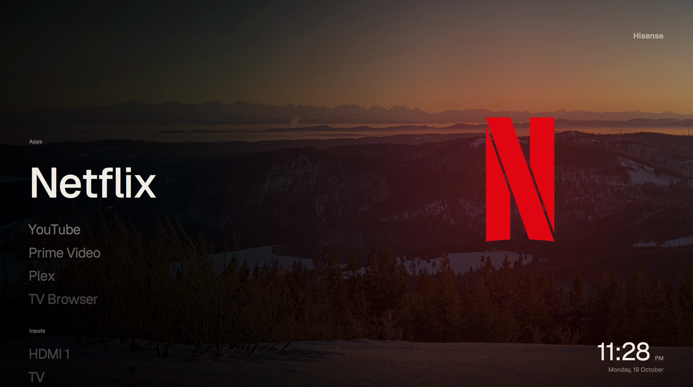
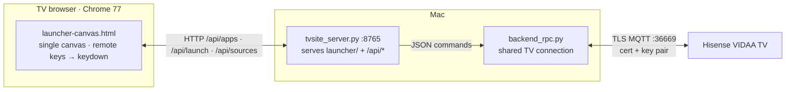
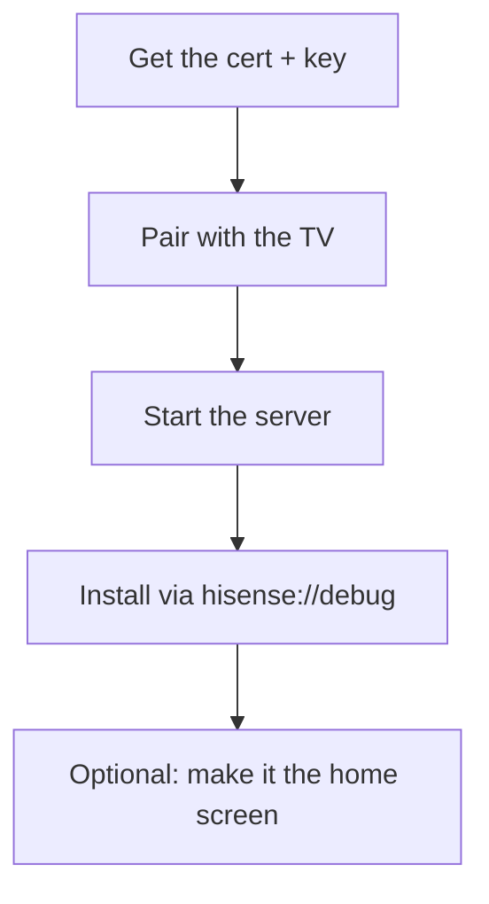
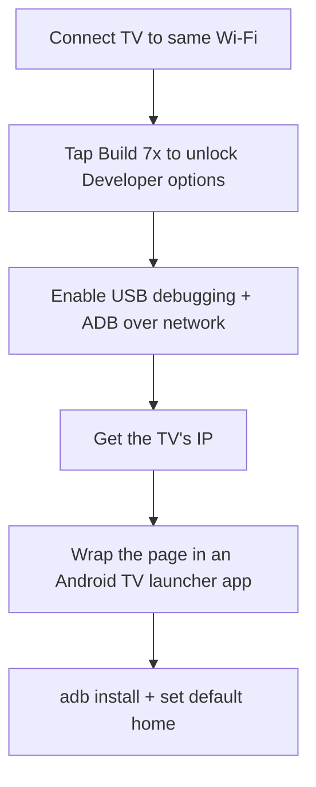

<p align="center">
  
</p>

<h1 align="center">vidaa-launcher</h1>

<p align="center">A custom home-screen launcher for Hisense VIDAA TVs, drawn on one canvas and driven by a small Python server on your Mac.</p>

The TV's old Chrome 77 GPU chokes on layered CSS, so the whole interface is drawn on a single `<canvas>`. The launcher is a plain web page installed through the TV's built-in debug installer, and it talks to a server that controls the TV over the same RemoteNow MQTT channel other open source Hisense projects use.

Pair with [hisensebar](https://github.com/Zfinix/hisensebar), the menu bar remote, for the full setup.

## Demo

<p align="center">
  
</p>

## Features

- **Home screen** with a large clock, rotating 4K wallpapers and a row of your apps and inputs
- **Apps and Inputs pages** with real app logos and live signal status
- **Real controls.** Pressing OK on a tile opens the app or switches the input on the TV
- **Floating nav** (Home / Apps / Inputs), ambient mode, settings for appearance, clock, wallpaper and rendering
- **Home takeover.** A watcher opens this launcher whenever the TV lands on VIDAA's home screen
- **Runs at 30 to 35 fps** on the TV after rendering to 720p and scaling up

## How it works



## Install



### 1. Get the certificate and key

Put these two files in `server/keys/`. They are the same files other open source Hisense remotes use (for example the `Hisense-mqtt-keyfiles` repo):

```
server/keys/rcm_certchain_pem.cer
server/keys/rcm_pem_privkey.pkcs8
```

### 2. Pair with the TV

The TV shows a 4-digit code on screen. Write it to `server/.paircode`, then run:

```sh
python3 server/pair_daemon.py
```

It prints `PAIRED` when the TV accepts the code.

### 3. Start the server

```sh
python3 server/tvsite_server.py launcher 8765
```

It serves the launcher at `http://<your-mac-ip>:8765/` and exposes the bridge APIs. If discovery can't find your TV, set the address:

```sh
HISENSE_HOST=192.168.1.50 python3 server/tvsite_server.py launcher 8765
```

### 4. Install it on the TV

1. On the TV, open the **TV Browser** and type `hisense://debug` in the address bar.
2. Enter the app name (`HisenseBar`) and the URL `http://<your-mac-ip>:8765/`, then hit **Install**.
3. The launcher is added as a channel. Open it from the TV's app list.

VIDAA has no setting to replace its home screen, so your app shows up as a normal channel.

### 5. Optional: make it the home screen

`server/home_watch.py` checks the TV every 3 seconds and opens the launcher app whenever the TV is on VIDAA's home screen:

```sh
python3 server/home_watch.py
```

To pause the takeover, create an empty file `server/.home_watch_off`. Delete it to resume.

The Mac must stay awake. The watcher uses `caffeinate` to hold off idle sleep; plug the Mac in or the takeover stops when it sleeps.

### 6. Optional: auto-start on the Mac

Two launchd agents: one for the server, one for the watcher. Put these in `~/Library/LaunchAgents/` with your paths, then `launchctl bootstrap gui/$(id -u) <file>`.

Server (`com.example.vidaa-launcher-site.plist`):

```xml
<?xml version="1.0" encoding="UTF-8"?>
<!DOCTYPE plist PUBLIC "-//Apple//DTD PLIST 1.0//EN" "http://www.apple.com/DTDs/PropertyList-1.0.dtd">
<plist version="1.0">
<dict>
  <key>Label</key><string>com.example.vidaa-launcher-site</string>
  <key>ProgramArguments</key>
  <array>
    <string>/usr/bin/python3</string>
    <string>/path/to/vidaa-launcher/server/tvsite_server.py</string>
    <string>/path/to/vidaa-launcher/launcher</string>
    <string>8765</string>
  </array>
  <key>WorkingDirectory</key><string>/path/to/vidaa-launcher</string>
  <key>RunAtLoad</key><true/>
  <key>KeepAlive</key><true/>
  <key>StandardOutPath</key><string>/tmp/vidaa-launcher-site.log</string>
  <key>StandardErrorPath</key><string>/tmp/vidaa-launcher-site.log</string>
</dict>
</plist>
```

Watcher (`com.example.vidaa-launcher-home.plist`): same shape, with

```xml
<array>
  <string>/usr/bin/caffeinate</string>
  <string>-is</string>
  <string>/usr/bin/python3</string>
  <string>-u</string>
  <string>/path/to/vidaa-launcher/server/home_watch.py</string>
</array>
```

## Requirements

- A Hisense VIDAA TV on the same network
- A Mac (or anything always-on) to run the server
- Python 3 with `paho-mqtt` v2: `pip install paho-mqtt`
- The RemoteNow client certificate and key (not in this repo)

## The launcher

`launcher/launcher-canvas.html` is the built page; `launcher-canvas.src.html` is identical (the source is self-contained). It draws at 1920x1080:

- **Photos:** 14 hand-picked Wikimedia Commons featured pictures, crossfading, with dark fades baked in so text stays readable
- **Glass panels:** pre-blurred copies of the photo, tinted, with soft shadows
- **Remote keys:** the TV forwards remote presses as keyboard events, handled in the page
- **Settings** persist in `localStorage`: 12/24-hour clock, glass vs high contrast, wallpaper rotation, Smooth (720p upscale, ~35 fps) vs Sharp (1080p, ~25 fps) rendering

Perf notes: the TV's browser can't use full-screen offscreen canvases (they render empty), so the photo is drawn directly each frame; shadows are pre-rendered at quarter size; only the strip that changes is repainted.

App logos in `launcher/icons/` are official App Store icons. Wallpaper credits are in `launcher/bg/credits.json` (all CC BY-SA, credit required).

### App list

`server/tvsite_server.py` has a `SHOWN` list: only those apps appear, in that order. `apps_hidden.json` can hide more.

## Android TV / Xiaomi

The launcher is a plain web app, so it runs on any Android TV browser too. To make it a real launcher on Android TV (Xiaomi PatchWall, Google TV):



The Hisense button controls (app open, input switch) go through the Mac server and the Hisense MQTT channel, so on a Xiaomi those actions would need an Android equivalent (`adb shell am start`, `input keyevent` for HDMI CEC).

## Repo layout

```
launcher/            the page the TV loads (html, wallpapers, icons, font)
server/tv.py         Hisense MQTT client (TLS, cert pair, keys, apps, sources)
server/discover.py   SSDP discovery
server/backend_rpc.py  single shared TV connection, JSON commands
server/tvsite_server.py  HTTP server + /api bridge
server/home_watch.py   home takeover watcher
server/pair_daemon.py  pairing flow
```

## License

MIT. Wallpapers are CC BY-SA, credited in `launcher/bg/credits.json`. App logos belong to their owners. Not affiliated with Hisense.
